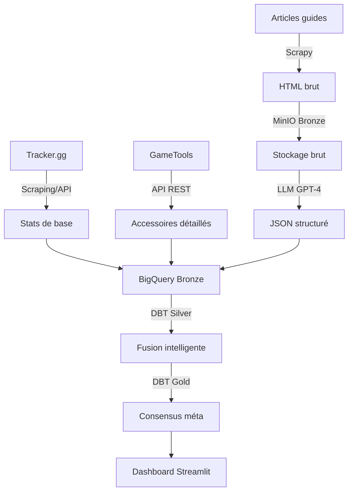

# 🎯 Stratégie d'extraction - Battlefield Meta Aggregator

**Date** : 16 octobre 2025  
**Phase** : 0.5 (Exploration terminée)  
**Approche** : Hybride (API + Scraping + LLM)

---

## 📊 Vue d'ensemble

**Problème identifié** :
- ❌ Pas d'API EA/DICE publique documentée
- ✅ Tracker.gg : Excellente base de données (stats armes, win rates)
- ⚠️ Tracker.gg manque granularité accessoires/loadouts complets
- 🔍 Besoin d'enrichir avec sources communautaires

**Solution retenue** : **Architecture hybride en 3 couches**

```
Layer 1 : Base de données (Tracker.gg)
   └─> Stats armes, win rates, pick rates

Layer 2 : Enrichissement API (GameTools)
   └─> Accessoires détaillés, configurations

Layer 3 : Extraction intelligente LLM
   └─> Articles guides → Loadouts + contexte
```

---

## 🔧 Architecture technique

### 1. Sources de données finales

| Priorité | Source | Méthode | Rôle | Données |
|----------|--------|---------|------|---------|
| 🔴 **CRITICAL** | **Tracker.gg** | Scraping/API | Base de données | Stats armes, méta général |
| 🔴 **HIGH** | **GameTools** | API REST | Enrichissement | Accessoires, loadouts détaillés |
| 🟢 **MEDIUM** | **Reddit** | API officielle | Méta communauté | Discussions, tendances |
| 🟡 **SUPPORT** | PC Gamer | Scrapy + LLM | Guides enrichis | Analyses expertes |
| 🟡 **SUPPORT** | Skycoach | Scrapy + LLM | Loadouts pros | Configurations optimales |
| 🟡 **SUPPORT** | Gam3s.gg | Scrapy + LLM | Tier lists | Classements patch |

### 2. Workflow d'extraction



---

## 🤖 Innovation : Extraction LLM

### Pourquoi le LLM ?

**Problème** : HTML hétérogène et non structuré
- Différents formats par site
- Informations implicites ("best for aggressive play")
- Évolution constante du HTML

**Solution** : GPT-4 extraction intelligente
- Comprend le contexte et les nuances
- S'adapte aux changements de format
- Extrait recommandations implicites
- Scoring de confiance automatique

### Processus d'extraction

#### Étape 1 : Crawling
```python
# Scrapy crawl articles
scrapy crawl pcgamer -o data/outputs/pcgamer.json

# Output
{
  "url": "https://pcgamer.com/battlefield-loadout",
  "html": "<html>...</html>",
  "crawled_at": "2025-10-16T10:00:00"
}
```

#### Étape 2 : LLM Processing
```python
# Prompt structuré
prompt = """
Analyse cet article Battlefield et extrais les loadouts au format JSON.

HTML: {html_content}

Format attendu:
{
  "weapons": [
    {
      "name": "nom exact",
      "category": "AR/SMG/Sniper/LMG",
      "loadout": {
        "optic": "...",
        "barrel": "...",
        "magazine": "...",
        "underbarrel": "...",
        "stock": "..."
      },
      "pros": ["..."],
      "cons": ["..."],
      "best_for": "situation",
      "meta_tier": "S/A/B/C",
      "confidence": 0.0-1.0
    }
  ]
}

Règles:
- Extrais SEULEMENT les infos explicites
- null si accessoire non mentionné
- confidence = fiabilité (1.0 = très sûr)
"""

# Exécution
from langchain.chat_models import ChatOpenAI
llm = ChatOpenAI(model="gpt-4")
result = llm.predict(prompt.format(html_content=html))
```

#### Étape 3 : Validation
```python
from pydantic import BaseModel, Field

class WeaponLoadout(BaseModel):
    name: str
    category: str
    loadout: dict
    confidence: float = Field(ge=0.0, le=1.0)

# Validation
validated = WeaponLoadout(**json.loads(result))

# Upload BigQuery
upload_to_bigquery(validated, "bronze_llm_extractions")
```

### Coût et alternatives

**GPT-4 (payant)** :
- Coût : ~$0.03 / 1K tokens
- Article moyen : ~10K tokens = $0.30
- 50 articles/mois : **~$15/mois**

**Alternatives gratuites** :
- **Llama 3** (Meta) : Via Ollama (local)
- **Mistral** : Via Ollama (local)
- **Claude** : API Anthropic (similaire GPT-4)

**Recommandation** : Commencer avec GPT-4, migrer vers Ollama + Llama 3 si coût devient problème

---

## 📊 Schéma de données

### Bronze Layer (Raw data)

```sql
-- Table 1: Tracker.gg base
CREATE TABLE bronze_tracker_weapons (
  weapon_name STRING,
  weapon_type STRING,
  damage INT64,
  fire_rate INT64,
  accuracy FLOAT64,
  win_rate FLOAT64,
  pick_rate FLOAT64,
  crawled_at TIMESTAMP,
  source STRING
);

-- Table 2: HTML articles bruts
CREATE TABLE bronze_html_articles (
  article_url STRING,
  html_content STRING,
  source_site STRING,
  crawled_at TIMESTAMP
);

-- Table 3: Extractions LLM
CREATE TABLE bronze_llm_extractions (
  extraction_id STRING,
  article_url STRING,
  weapon_name STRING,
  loadout_data JSON,
  confidence_score FLOAT64,
  extracted_at TIMESTAMP
);
```

### Silver Layer (Cleaned & merged)

```sql
-- Fusion Tracker + LLM + GameTools
CREATE TABLE silver_weapons (
  weapon_id STRING,
  weapon_name_normalized STRING,     -- PW7A2 → MP7
  weapon_category STRING,             -- AR, SMG, etc.
  
  -- Stats de base (Tracker.gg)
  base_stats STRUCT<
    damage INT64,
    fire_rate INT64,
    accuracy FLOAT64,
    range INT64
  >,
  
  -- Méta stats (Tracker.gg)
  win_rate FLOAT64,
  pick_rate FLOAT64,
  
  -- Enrichissement (GameTools + LLM)
  recommended_loadouts ARRAY<STRUCT<
    source STRING,
    attachments ARRAY<STRUCT<
      slot STRING,
      item STRING,
      impact STRING
    >>,
    confidence FLOAT64
  >>,
  
  meta_score FLOAT64,
  data_quality_score FLOAT64,
  last_updated TIMESTAMP
);
```

### Gold Layer (Business KPIs)

```sql
-- Consensus multi-sources
CREATE TABLE gold_meta_consensus (
  weapon_name STRING,
  overall_rank INT64,
  meta_score FLOAT64,
  
  -- Best loadout (consensus)
  best_loadout STRUCT<
    attachments ARRAY<STRING>,
    sources ARRAY<STRING>,
    consensus_level STRING,          -- High/Medium/Low
    agreement_score FLOAT64          -- 0.0-1.0
  >,
  
  -- Performance metrics
  win_rate_avg FLOAT64,
  pick_rate_avg FLOAT64,
  
  -- Trend analysis
  trend STRING,                      -- Rising/Stable/Falling
  trend_direction FLOAT64,           -- +15% = 0.15
  last_patch_impact FLOAT64,
  
  -- Metadata
  sources_count INT64,
  last_updated TIMESTAMP,
  confidence_avg FLOAT64
);
```

---

## 🔄 Pipeline DBT

### Modèles prévus

```
dbt/models/
├── bronze/
│   ├── bronze_tracker_raw.sql       # Import Tracker.gg
│   ├── bronze_html_raw.sql          # Import HTML articles
│   └── bronze_llm_raw.sql           # Import LLM extractions
│
├── silver/
│   ├── silver_weapons_base.sql      # Nettoyage Tracker
│   ├── silver_llm_loadouts.sql      # Parse LLM JSON
│   ├── silver_weapons_merged.sql    # Fusion sources
│   └── silver_weapons_normalized.sql # Normalisation noms
│
└── gold/
    ├── gold_meta_consensus.sql      # Consensus final
    ├── gold_weapon_rankings.sql     # Top armes
    ├── gold_loadout_popularity.sql  # Loadouts populaires
    └── gold_trend_analysis.sql      # Analyse tendances
```

### Exemple de modèle Silver

```sql
-- models/silver/silver_weapons_merged.sql
WITH tracker_data AS (
  SELECT * FROM {{ ref('bronze_tracker_raw') }}
),
llm_data AS (
  SELECT * FROM {{ ref('silver_llm_loadouts') }}
),
merged AS (
  SELECT 
    t.weapon_name,
    t.win_rate,
    t.pick_rate,
    ARRAY_AGG(
      STRUCT(
        l.source,
        l.loadout_attachments,
        l.confidence_score
      )
    ) AS recommended_loadouts
  FROM tracker_data t
  LEFT JOIN llm_data l
    ON LOWER(t.weapon_name) = LOWER(l.weapon_name)
  GROUP BY t.weapon_name, t.win_rate, t.pick_rate
)
SELECT * FROM merged
```

---

## 🚀 Plan d'implémentation Phase 1

### Sprint 1 : Tracker.gg scraper (3-4 jours)
```
[ ] Analyser structure Tracker.gg (DevTools)
[ ] Créer tracker_scraper.py (Scrapy)
[ ] Parser stats armes (JSON)
[ ] Tests unitaires
[ ] Upload MinIO
```

### Sprint 2 : GameTools API (2-3 jours)
```
[ ] Explorer API GameTools
[ ] Créer gametools_client.py
[ ] Parser accessoires/loadouts
[ ] Mapper avec Tracker weapons
[ ] Tests intégration
```

### Sprint 3 : LLM Extraction (4-5 jours)
```
[ ] Setup LangChain + OpenAI
[ ] Créer prompts structurés
[ ] Implémenter html_processor.py
[ ] Validation Pydantic schemas
[ ] Tests avec articles réels
[ ] Coût monitoring
```

### Sprint 4 : Upload & intégration (2 jours)
```
[ ] Script upload_to_minio.py
[ ] BigQuery tables creation
[ ] Tests pipeline complet
[ ] Documentation
```

**Durée totale estimée** : 11-14 jours

---

## 📈 Métriques de succès

### Qualité des données
- ✅ **Coverage** : >90% des armes méta capturées
- ✅ **Freshness** : Données <24h
- ✅ **Accuracy** : Consensus >80% entre sources
- ✅ **Confidence** : Score LLM >0.7 (70%)

### Performance technique
- ✅ **Crawl time** : <30 min pour toutes les sources
- ✅ **LLM processing** : <5 min pour 10 articles
- ✅ **Coût LLM** : <$20/mois
- ✅ **Pipeline end-to-end** : <1h total

### Business value
- ✅ **Loadouts complets** : >50 armes documentées
- ✅ **Multi-sources** : ≥3 sources par arme
- ✅ **Mise à jour** : Quotidienne automatique
- ✅ **Dashboard** : Temps réel (<5 min latence)

---

## 🎯 Prochaines étapes

1. **Immédiat** : Analyser Tracker.gg en détail (DevTools, structure)
2. **Cette semaine** : Implémenter tracker_scraper.py (Sprint 1)
3. **Semaine prochaine** : Explorer GameTools API (Sprint 2)
4. **Semaine +2** : Setup LLM extraction (Sprint 3)

**📖 Voir NEXT_STEPS.md pour actions détaillées**

---

## 📚 Ressources

- **LangChain Docs** : https://docs.langchain.com/
- **OpenAI API** : https://platform.openai.com/docs
- **Ollama (LLM local)** : https://ollama.ai/
- **DBT Docs** : https://docs.getdbt.com/
- **Tracker.gg** : https://tracker.gg/battlefield-2042

---

**Stratégie validée le 16 octobre 2025** ✅  
**Prêt pour implémentation Phase 1** 🚀
