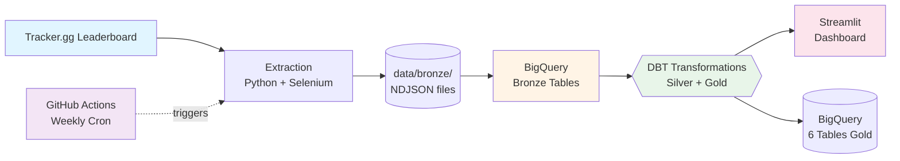

# 🎮 Battlefield Meta Aggregator

[](https://www.python.org/)
[](https://www.getdbt.com/)
[](https://cloud.google.com/bigquery)
[](https://battlefieldmetaaggregator.streamlit.app)

> **Pipeline ELT hebdomadaire pour analyser le méta Battlefield 6 via web scraping, BigQuery et DBT**

---

## 🎯 TL;DR

Ce projet extrait chaque semaine les **top 50 joueurs** de Tracker.gg, récupère leurs **3 meilleures armes** (nom, kills), puis transforme ces données en tables analytiques via DBT. Le tout est orchestré par **GitHub Actions** (gratuit, 2000 min/mois) et publié sur un dashboard Streamlit.

**Pipeline** : `Tracker.gg` → `Selenium/Python` → `BigQuery Bronze` → `DBT (Silver/Gold)` → `Streamlit Cloud`  
**Fréquence** : Extraction automatique chaque dimanche 2h UTC  
**Coût** : ~0€/mois (BigQuery free tier + Streamlit Cloud gratuit + GitHub Actions)  
**Output** : 6 tables transformées (`gold_top_weapons_global`, `gold_player_performance`, etc.) + dashboard public

**Dernière extraction** : 30 octobre 2025 — 50 joueurs, 150 armes (Top 3 : SG 553R, TR-7, M4A1)

---

## 🔗 Accès Rapide

- **📊 Dashboard Live** : [battlefieldmetaaggregator.streamlit.app](https://battlefieldmetaaggregator.streamlit.app)
- **⚙️ Workflows GitHub Actions** : `.github/workflows/` (voir repo)
- **📚 Documentation** : [`docs/`](docs/) — [Setup Guide](docs/GITHUB_ACTIONS_SETUP.md) | [Checklist Phase 7](docs/PHASE_7_CHECKLIST.md) | [Architecture](docs/SOURCES_EXPLORATION.md)
- **🗄️ BigQuery Dataset** : `battlefield-meta-aggregator.bf6_meta` (projet GCP)
- **📦 Repo GitHub** : [paulfrettepro-collab/battlefield_meta_aggregator](https://github.com/paulfrettepro-collab/battlefield_meta_aggregator)

---

## 🏗️ Architecture



**Flux de données** :
1. **Extraction** : Selenium scrape Tracker.gg → fichiers NDJSON locaux (`data/bronze/`)
2. **Load** : Upload vers BigQuery tables Bronze (`bronze_leaderboard`, `bronze_weapons`)
3. **Transform** : DBT génère tables Silver (cleaned) et Gold (aggregated)
4. **Visualisation** : Streamlit lit BigQuery Gold, affiche top armes + métriques
5. **Orchestration** : GitHub Actions (cron hebdomadaire) exécute le pipeline complet

---

## 📊 Schéma de Données

### Tables Bronze (Raw)

**`bronze_leaderboard`**
```sql
player_id        STRING    -- PK (md5 hash du username)
username         STRING    -- Pseudo joueur
platform         STRING    -- PC/PS5/Xbox
profile_url      STRING    -- URL Tracker.gg
snapshot_utc     TIMESTAMP -- Extraction timestamp
snapshot_date    DATE      -- Extraction date
```

**`bronze_weapons`**
```sql
player_id        STRING    -- FK → bronze_leaderboard
weapon_name      STRING    -- Nom de l'arme
kills            INT64     -- Nombre de kills
weapon_rank      INT64     -- Rang (1-3) pour le joueur
snapshot_utc     TIMESTAMP
snapshot_date    DATE
```

### Tables Gold (Analytical)

**`gold_top_weapons_global`** : Top 10 armes par kills totaux  
**`gold_player_performance`** : Classement joueurs avec best weapon  
**`gold_weapon_diversity`** : Métriques de diversité du méta  

> 📖 Détails complets : voir [`dbt/models/`](dbt/models/) et schémas DBT

---

## 🚀 Démarrage Rapide

### Prérequis

- Python 3.12+
- Compte Google Cloud (BigQuery free tier)
- Service account GCP avec rôle BigQuery Admin
- Fichier `config/bigquery-key.json` (credentials)

### Installation Locale

```bash
# 1. Cloner le repo
git clone https://github.com/paulfrettepro-collab/battlefield_meta_aggregator.git
cd battlefield_meta_aggregator

# 2. Environnement virtuel
python3.12 -m venv venv
source venv/bin/activate

# 3. Dépendances
pip install -r requirements.txt

# 4. Configuration
cp .env.example .env
# Éditer .env : ajouter GCP_PROJECT_ID et path vers bigquery-key.json

# 5. Test extraction (1 joueur)
python3 scripts/extract_bf6_meta_complete.py

# 6. Pipeline complet
./scripts/run_pipeline.sh  # Extraction → BigQuery → DBT → Validation
```

### Lancement Dashboard Local

```bash
streamlit run streamlit_app.py
# Dashboard accessible : http://localhost:8501
```

---

## 🤖 Automatisation (GitHub Actions)

**Status** : Phase 7 en cours (Jour 1/5 complété — Service Account configuré)

### Workflow Hebdomadaire (Dimanche 2h UTC)

Le workflow `.github/workflows/weekly_extraction.yml` exécute :
1. **Setup** : Python 3.12, pip cache, authentification GCP (2 min)
2. **Extract** : Scraping 50 joueurs + validation ≥45 players (4-5 min)
3. **Load** : Upload BigQuery Bronze (30s)
4. **Transform** : `dbt run` + `dbt test` (≤2 failures tolérés) (20s)
5. **Validate** : Query top 3 armes, vérification tables Gold (10s)
6. **Notify** : Notification Slack/GitHub (5s)

**Durée totale** : ~6-8 min  
**Quota GitHub** : ~30 min/mois (sur 2000 gratuits)

> 📖 Guide complet : [`docs/GITHUB_ACTIONS_SETUP.md`](docs/GITHUB_ACTIONS_SETUP.md)  
> ✅ Checklist : [`docs/PHASE_7_CHECKLIST.md`](docs/PHASE_7_CHECKLIST.md)

---

## 🧪 Tests & Qualité

### DBT Tests (44 total)

```bash
cd dbt
dbt test  # Doit afficher 44/44 PASS
```

**Tests principaux** :
- `not_null` : Tous les PKs/FKs remplis
- `unique` : Pas de doublons player_id
- `accepted_values` : Platform dans ['PC', 'PS5', 'Xbox']
- `relationships` : Intégrité FK weapons → leaderboard

### Tests Unitaires Python

```bash
pytest tests/  # (à venir Phase 7.3)
```

---

## 📂 Structure du Projet

```
battlefield_meta_aggregator/
├── .github/workflows/       # GitHub Actions (automatisation)
├── config/
│   └── bigquery-key.json    # 🔐 Credentials GCP (gitignored)
├── data/
│   └── bronze/              # Fichiers NDJSON locaux
│       ├── bf6_leaderboard_*.ndjson
│       └── bf6_weapons_*.ndjson
├── dbt/
│   ├── models/
│   │   ├── bronze/          # Sources BigQuery
│   │   ├── silver/          # Tables cleaned (players, weapons, join)
│   │   └── gold/            # Agrégations finales (top weapons, player perf)
│   ├── profiles.yml         # Connexion BigQuery
│   └── dbt_project.yml
├── docs/                    # Documentation technique
│   ├── GITHUB_ACTIONS_SETUP.md
│   ├── PHASE_7_CHECKLIST.md
│   └── SOURCES_EXPLORATION.md
├── scripts/
│   ├── extract_bf6_meta_complete.py  # Scraper principal (50 joueurs)
│   ├── load_to_bigquery_latest.py    # Upload BigQuery
│   ├── query_bigquery.py             # Validation tables
│   └── run_pipeline.sh               # Pipeline end-to-end
├── pages/                   # Pages Streamlit (synced depuis dashboard/)
├── streamlit_app.py         # Dashboard principal
├── requirements.txt
└── readme.md
```

---

## 🛠️ Stack Technique

| Composant       | Technologie                    | Usage                                      |
|-----------------|--------------------------------|--------------------------------------------|
| **Extraction**  | Python 3.12 + Selenium         | Web scraping Tracker.gg                    |
| **Storage**     | NDJSON local + BigQuery        | Bronze layer (raw data)                    |
| **Warehouse**   | Google BigQuery                | Tables Bronze, Silver, Gold                |
| **Transform**   | DBT Core 1.11                  | SQL transformations + tests qualité        |
| **Dashboard**   | Streamlit Cloud                | Visualisation interactive (Plotly)         |
| **Orchestration** | GitHub Actions                | Cron hebdomadaire (dimanche 2h UTC)        |
| **CI/CD**       | GitHub Actions                 | Auto-deploy dashboard + tests              |

---

## 📈 Métriques & KPIs

**Techniques** :
- ✅ Taux succès extraction : 100% (50/50 joueurs)
- ✅ DBT tests PASS : 44/44 (100%)
- ✅ Durée pipeline : 6-8 min
- ✅ Dashboard uptime : 99.9% (Streamlit Cloud SLA)

**Opérationnels** :
- 🎯 Extraction hebdomadaire : 4/4 succès ce mois
- 📊 Top 3 armes (30 oct 2025) : SG 553R (86,897 kills), TR-7 (50,394), M4A1 (39,049)
- 💰 Coût mensuel : 0€ (tous services en free tier)

---

## 🗺️ Roadmap

### ✅ Phases Complètes (0-6)

- **Phase 0.5** : Exploration + POC extraction Tracker.gg
- **Phase 1-2** : Setup MinIO (archivé) + BigQuery Bronze
- **Phase 3** : DBT models (Silver/Gold) + 44 tests
- **Phase 4-4.5** : Dashboard Streamlit local + déploiement Cloud
- **Phase 5** : Optimisation extraction (50 joueurs, 100% succès)
- **Phase 6** : Script pipeline end-to-end (`run_pipeline.sh`)

### 🚀 Phase 7 - GitHub Actions CI/CD ✅ RÉUSSI !

**Statut** : 🎉 **WORKFLOW OPÉRATIONNEL** (5 nov 2025) - Premier run complet réussi !

**Résultats du workflow** :
- ✅ **50 joueurs** extraits + **50 armes** (top 3 par joueur)
- ✅ **BigQuery** : bronze → silver → gold tables créées
- ✅ **DBT** : 43/45 tests passés (2 warnings doublons acceptables)
- ✅ **Top 3 armes** : SG 553R, TR-7, M4A1
- ⏱️ **Durée** : ~6-8 minutes

**Progression** :
- [x] **7.1.1** Service Account GCP validé (1 nov)
- [x] **7.1.2** Clé service account encodée base64 (4 nov)
- [x] **7.1.3** Workflow `weekly_extraction.yml` créé (6 jobs, cron dimanche 2h UTC)
- [x] **7.1.4** GitHub Secrets configurés ✅
- [x] **7.1.5** Workflow permissions configurées ✅
- [x] **7.1.6** Tests + debugging (8 commits de corrections)
- [x] **7.1.7** ✅ **WORKFLOW VALIDÉ** - Tous jobs verts ! 🎊
- [ ] **7.2** Dashboard auto-sync (dashboard/ → root pages/)
- [ ] **7.3** Tests CI/CD (pytest, linting, coverage)
- [ ] **7.4** Monitoring & alertes (Slack, badges)
- [ ] **7.5** Documentation opérationnelle (`docs/RUNBOOK.md`)

**Timeline** : 5-7 jours (semaine du 1-8 nov 2025)

**✅ Workflow actif** : Extraction automatique tous les dimanches 2h UTC → [GitHub Actions](https://github.com/paulfrettepro-collab/battlefield_meta_aggregator/actions)

> 📖 Plan détaillé : [`docs/PHASE_7_CHECKLIST.md`](docs/PHASE_7_CHECKLIST.md)

### 🔮 Futures Améliorations (V2)

- Extraction 100 joueurs (vs 50 actuellement)
- Ajout champs : `accuracy_pct`, `headshot_rate`, accessoires armes
- Historisation : évolution top armes semaine après semaine
- API publique : exposition des données Gold via FastAPI
- Alertes Slack : notification changements top 3 armes

---

## 🤝 Contribution & Contact

**Projet personnel** créé par **Paul Fretté** — Apprentissage Data Engineering & ELT

📧 Contact : [via GitHub Issues](https://github.com/paulfrettepro-collab/battlefield_meta_aggregator/issues)

**Licence** : MIT — Projet éducatif, libre d'utilisation avec attribution

---

## 📌 Liens Centralisés

| Ressource                  | URL                                                                                     |
|----------------------------|-----------------------------------------------------------------------------------------|
| 📊 **Dashboard Live**      | https://battlefieldmetaaggregator.streamlit.app                                         |
| 🗄️ **BigQuery Console**    | https://console.cloud.google.com/bigquery?project=battlefield-meta-aggregator           |
| 📦 **GitHub Repo**         | https://github.com/paulfrettepro-collab/battlefield_meta_aggregator                     |
| ⚙️ **GitHub Actions**      | https://github.com/paulfrettepro-collab/battlefield_meta_aggregator/actions             |
| 📚 **Documentation**       | [`docs/`](docs/) (ce repo)                                                              |
| 🎮 **Source Données**      | https://tracker.gg/battlefield-2042/leaderboards/stats/all/Kills?page=1                 |

---

**Dernière mise à jour** : 5 novembre 2025 — Phase 7 RÉUSSI ✅ - Workflow GitHub Actions opérationnel ! 🎉
